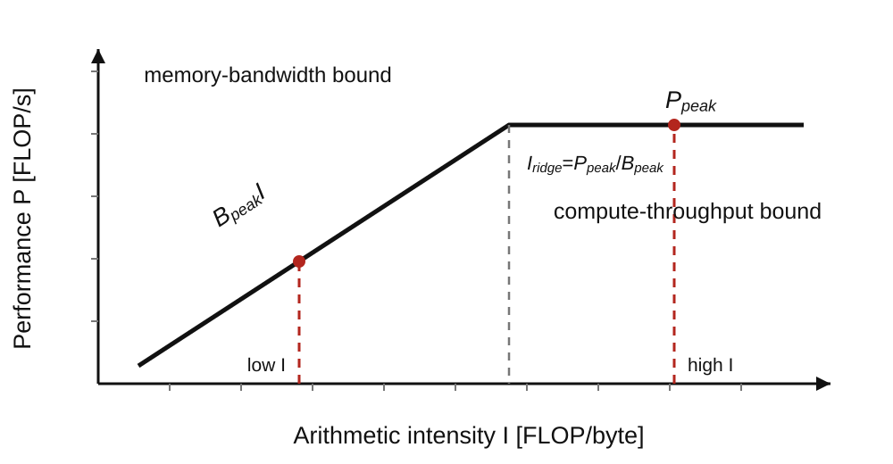

# Performance Models for CUDA Kernels

## Arithmetic intensity, roofline, and naive matrix multiplication

GPU Programming for AI  
Lecture 7

---

# Naive matrix multiplication: performance gap

For $M=N=K=512$:

$$
\text{work}=2MNK=268{,}435{,}456\ \text{FLOPs}
$$

| Quantity | Value used in the lab |
|---|---:|
| measured kernel performance | 788 GFLOP/s |
| RTX 3060 FP32 peak | 9.462 TFLOP/s |
| measured / peak | 8.3% |

* Why do we use the GFLOPS/s metric here?

---

# Bandwidth and compute throughput

| Kernel | Useful performance measure |
|---|---|
| copy | GB/s |
| transpose | GB/s |
| matrix multiplication | GFLOP/s |

Copy and transpose perform *little* (or no) arithmetic for every transferred byte.

Which metric we would be useful for the dot product kernel?

The relevant question is how much computation the implementation performs for its memory traffic. This is captured by *arithmetic intensity* (I).

---

# Arithmetic intensity

Arithmetic intensity relates work to memory traffic:

$$
I=\frac{\text{floating-point operations}}
        {\text{bytes transferred}}
\qquad [\text{FLOP/byte}]
$$

Higher arithmetic intensity means more computation for each transferred byte.

The denominator depends on the memory level (L1, L2, DRAM). DRAM is the ultimate limitation for large buffers (we need to read the data at least once).

Note: small buffers may fit into the L2 and we need to consider L2 bandwidth (small problems have overhead limitations though e.g. kernel launch).

---

# The roofline bound

For arithmetic intensity $I$:

$$
P \leq \min\left(P_{\text{peak}},\ B_{\text{peak}}I\right)
$$

Units:

* $P$ and $P_{\text{peak}}$: FLOP/s
* $B_{\text{peak}}$: byte/s
* $I$: FLOP/byte

It is visualized on the roofline diagram:

| Roofline region | Main ceiling |
|---|---|
| sloped region | memory bandwidth |
| flat region | compute throughput |

---

# A usual roofline diagram



<p class="source-note">Source: “Example of a naive Roofline model,” Wikimedia Commons, CC BY-SA 4.0.</p>

---

# Memory bound to compute bound phase change

The ridge point is:

$$
I_{\text{ridge}}=\frac{P_{\text{peak}}}{B_{\text{peak}}}
$$

Implications:

* A point far below either roof indicates another inefficiency or insufficient parallel work.

* The ridge point is the minimum arithmetic intensity at which peak compute throughput becomes attainable.

---

# RTX 3060 arithmetic intensity

For the 12 GB model:

$$
P_{\text{peak}} = 9.462\ \mathrm{TFLOP/s},
\qquad
B_{\text{peak}} = 360\ \mathrm{GB/s}
$$

$$
\begin{aligned}
I_{\text{ridge}}
&= \frac{P_{\text{peak}}}{B_{\text{peak}}} \\
&= \frac{9.462 \times 10^{12}\ \mathrm{FLOP/s}}
         {360 \times 10^9\ \mathrm{byte/s}} \\
&\approx 26.3\ \mathrm{FLOP/byte}
\end{aligned}
$$

In other words, the GPU compute units are underutilized if they perform less than 4x26.3 floating point operations on each float value transferred between the chip and the DRAM.

---

# The naive matrix multiplication kernel requests little reuse

One thread computes one output value:

```cpp
float sum = 0.0f;
for (int k = 0; k < K; ++k) {
    sum += A[row * K + k] * B[k * N + column];
}
C[row * N + column] = sum;
```

Per output element:

$$
\text{work}=K\text{ multiplications}+K\text{ additions}=2K, \qquad
\text{requested bytes}=8K+4
$$

For $K=512$, the work is $1024$ FLOPs and the ratio is approximately $0.25$ FLOP/byte.

In other words, the naive kernel loads the same data from tha A and B matrices many times.

---

# 3060 matmul perf example

Recall that the naive matrix multiplication reached

$$
P_{\text{measured}}=788\ \mathrm{GFLOP/s}
\qquad (M=N=K=512).
$$

Its estimated arithmetic intensity is

$$
I_{\text{naive},512}=0.25\ \mathrm{FLOP/byte}.
$$

Using the peak DRAM bandwidth:

$$
\begin{aligned}
P_{\text{estimated}}
&=B_{\text{peak}}I_{\text{naive},512} \\
&=360\ \mathrm{GB/s}\times0.25\ \mathrm{FLOP/byte} \\
&=90\ \mathrm{GFLOP/s}.
\end{aligned}
$$

- Why is the measured performance, $788\ \mathrm{GFLOP/s}$, higher than the estimated $90\ \mathrm{GFLOP/s}$?

---

# Matrix multiplication contains much more reuse

If each matrix element crossed the DRAM boundary only once:

$$
I_{\text{ideal}}=
\frac{2MNK}
     {4(MK+KN+MN)}
$$

For $M=N=K=512$:

$$
I_{\text{ideal}} \approx 85.3\ \text{FLOP/byte}
$$

The arithmetic is unchanged. The difference comes from reusing loaded values (not loading the data multiple times).

This is the theoretical ideal case: all the data is loaded into the registers.

Still useful to estimate the lower bound: multiply of 16 by 16 matrices have arithmetic intensity of $10.67$ even in the ideal case that is less than the $26.3$ the RTX3060 capable of.

---

# Memory access in the naive kernel

For a fixed loop iteration `k`:

```text
A[row, k]       same value for threads computing the same row
B[k, column]    adjacent columns request adjacent values
```

The implementation has useful properties:

- stores to `C` are coalesced
- accesses to a row of `B` are coalesced
- repeated `A` addresses can use broadcast and cache behavior

However, different blocks request overlapping regions of `A` and `B` without explicit cooperation.

Cache reuse can reduce DRAM traffic, but the kernel does not control that reuse.

---

# Profiler-guided diagnosis

Profile the marked iteration:

```bash
ncu --set full --nvtx \
  --nvtx-include 'regex:matmul_naive iteration 23/' \
  -o build/matmul-report -f ./build/matmul
```

Suggested order:

1. Check absolute kernel duration and launch dimensions.
2. Locate the achieved point on the roofline chart.
3. Inspect compute and memory throughput.
4. Inspect memory traffic and cache hit rates.
5. Use source counters and stall reasons to explain the result.

Change one thing, validate the result, then profile again.

---

# Optimization hypothesis

A thread block computes a tile of `C`.

The block could:

- load a tile of `A` once
- load a tile of `B` once
- reuse both tiles from shared memory
- accumulate several multiply-add operations per global load

Expected effect:

$$
\text{less global-memory traffic}
\quad\Longrightarrow\quad
\text{higher arithmetic intensity}
$$

The next step is to implement the tiled kernel and measure whether the hypothesis is correct.
