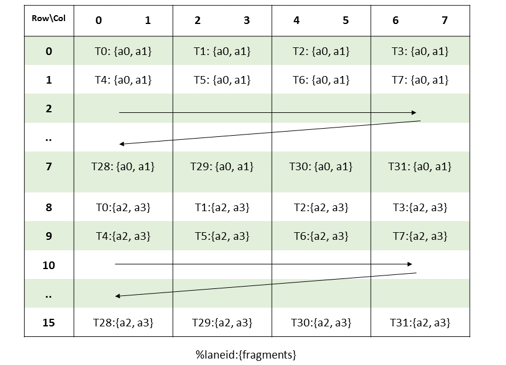
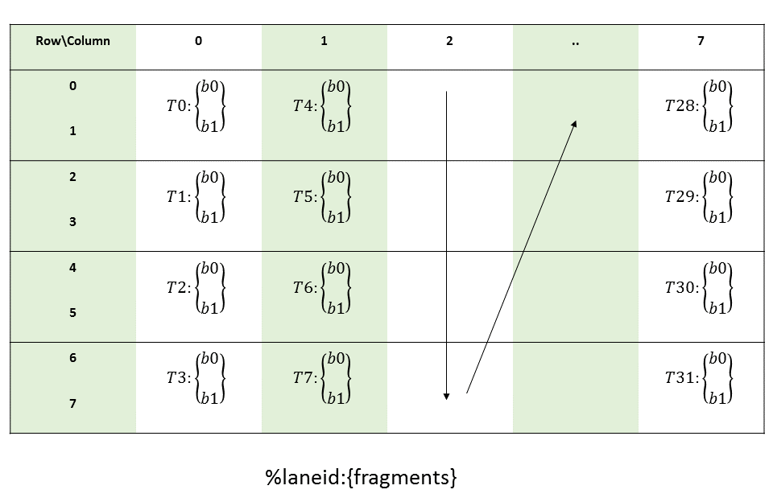
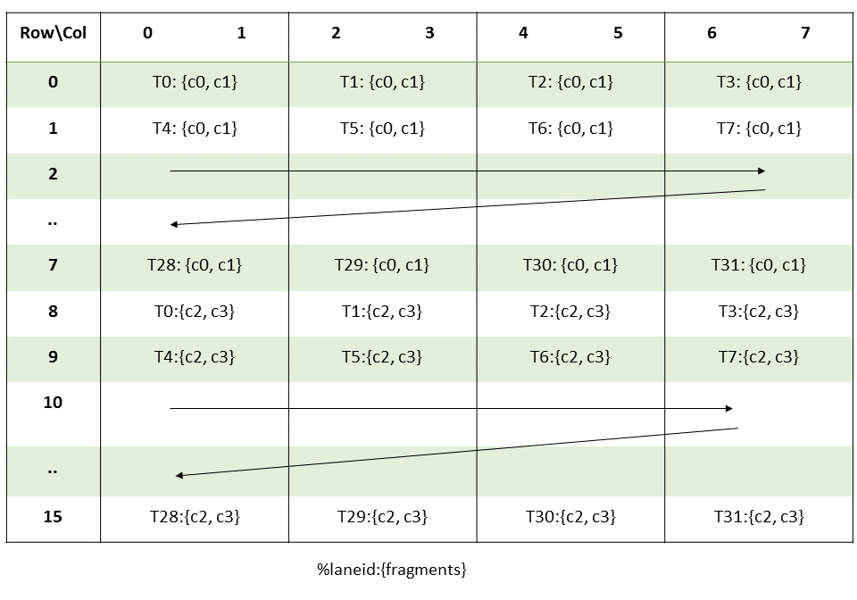

<!-- _paginate: false -->
<!-- _footer: "" -->

# cuBLAS, Mixed Precision, and Tensor Cores

## From a hand-optimized GEMM to specialized library kernels

GPU Programming for AI  
Lecture 9

<!--
The starting point is the hand-optimized FP32 GEMM from the previous sessions: shared-memory tiling, thread tiling, register accumulation, and measured parameter tuning.
-->

---

# cuBLAS

cuBLAS provides optimized implementations of Basic Linear Algebra Subprograms on NVIDIA GPUs.

Matrix multiplication uses the BLAS operation:

$$
C = \alpha AB + \beta C
$$

The library selects an implementation using information unavailable to a single fixed kernel:

- GPU architecture
- matrix dimensions and transpose operations
- storage and compute types
- alignment and leading dimensions

cuBLAS calls enqueue GPU work into a CUDA stream.

<!--
Ask: should one hand-tuned kernel remain optimal for square, narrow, small, and very large matrices?
Source: NVIDIA cuBLAS documentation:
https://docs.nvidia.com/cuda/cublas/
-->

---

<!-- _class: compact -->

# An FP32 cuBLAS baseline

**Host (CPU) code**

```cpp
cublasHandle_t handle;
check_cublas(cublasCreate(&handle));

check_cublas(
    cublasSetMathMode(handle, CUBLAS_PEDANTIC_MATH));

const float alpha = 1.0f;
const float beta  = 0.0f;

check_cublas(cublasSgemm(
    handle,
    CUBLAS_OP_N, CUBLAS_OP_N,
    N, M, K,
    &alpha,
    d_B, N,
    d_A, K,
    &beta,
    d_C, N));
```

`CUBLAS_PEDANTIC_MATH` makes this a useful prescribed-precision reference.

<!--
This matches the row-major workaround already used by 06/matmul.cu for validation.
cuBLAS operations are asynchronous with respect to the host when their scalar and pointer modes allow it. Use CUDA events in the same stream for timing.
Source: NVIDIA cuBLAS documentation, cublasSgemm and cublasMath_t:
https://docs.nvidia.com/cuda/cublas/
-->

---

# Row-major matrices in cuBLAS

The classic cuBLAS interface interprets matrices as column-major.

A row-major matrix and its transpose in column-major storage have the same byte layout.

For row-major inputs:

$$
C = AB
$$

compute:

$$
C^T = B^T A^T
$$

Therefore the cuBLAS call swaps `A` and `B`, and swaps the output dimensions `M` and `N`.

The leading dimension is the stride to the next column in the column-major interpretation.

<!--
Derive the argument order from the matrix dimensions rather than asking students to memorize the call.
The current course code passes d_B with leading dimension N and d_A with leading dimension K.
Source: NVIDIA cuBLAS documentation, matrix storage and GEMM parameters:
https://docs.nvidia.com/cuda/cublas/
-->

---

<!-- _class: compact -->

# `cublasGemmEx`

`cublasGemmEx` separates matrix storage types from the compute type.

**Host (CPU) code**

```cpp
check_cublas(cublasGemmEx(
    handle,
    CUBLAS_OP_N, CUBLAS_OP_N,
    N, M, K,
    &alpha,
    d_B, CUDA_R_32F, N,
    d_A, CUDA_R_32F, K,
    &beta,
    d_C, CUDA_R_32F, N,
    CUBLAS_COMPUTE_32F_FAST_TF32,
    CUBLAS_GEMM_DEFAULT));
```

The matrices remain FP32 in memory, while cuBLAS may use TF32 Tensor Core computation internally.

`CUBLAS_GEMM_DEFAULT_TENSOR_OP` is deprecated. Use an explicit compute type with `CUBLAS_GEMM_DEFAULT`.

<!--
Source: NVIDIA cuBLAS documentation, cublasGemmEx, cublasComputeType_t, and cublasGemmAlgo_t:
https://docs.nvidia.com/cuda/cublas/
-->

---

# Floating-point representation

For a normalized binary floating-point value:

$$
x = (-1)^s \times 1.f \times 2^{e-\text{bias}}
$$

| Field | Controls |
|---|---|
| sign | positive or negative value |
| exponent | approximate dynamic range |
| fraction | precision between adjacent values |

More exponent bits increase the representable range.

More fraction bits reduce rounding error.

Fewer bits reduce storage, memory traffic, and hardware cost.

<!--
The exact handling of zero, subnormal values, infinities, and NaNs is omitted from this introductory model.
Source: NVIDIA CUDA Programming Guide, Floating-Point Computation:
https://docs.nvidia.com/cuda/cuda-programming-guide/
-->

---

<!-- _class: compact -->

# Floating-point formats used in AI

| Format | Total bits | Exponent | Fraction | Main property |
|---|---:|---:|---:|---|
| FP32 | 32 | 8 | 23 | high single-precision accuracy |
| TF32 | internal | 8 | 10 | FP32 range, reduced precision |
| FP16 | 16 | 5 | 10 | compact, smaller dynamic range |
| BF16 | 16 | 8 | 7 | FP32-like range, lower precision |

TF32 is a Tensor Core compute format, not a normal CUDA storage type.

FP32 values remain in memory and are rounded internally for TF32 multiplication.

FP16 and BF16 can reduce both storage size and memory traffic when matrices are stored in 16-bit form.

<!--
The table counts explicit fraction bits. Normal values also have an implicit leading significand bit.
Sources:
NVIDIA CUDA Programming Guide, Supported Floating-Point Types:
https://docs.nvidia.com/cuda/cuda-programming-guide/
NVIDIA cuBLAS documentation, Alternate Floating Point:
https://docs.nvidia.com/cuda/cublas/
-->

---

<!-- _class: compact -->

# Mixed-precision GEMM

A GEMM operation is defined by several data types:

- input storage type
- multiplication precision
- accumulation precision
- output storage type

A common configuration is:

- FP16 or BF16 inputs
- Tensor Core multiplication
- FP32 accumulation
- FP32 output

FP32 accumulation preserves more information while summing the products of a long inner dimension.

Using FP32 matrices with a fast compute mode changes arithmetic precision but does not halve matrix storage.

<!--
Separate the benefit of a 16-bit storage format from the benefit of a reduced-precision compute path. They can be tested independently with cublasGemmEx.
Source: NVIDIA cuBLAS documentation, supported cublasGemmEx type combinations:
https://docs.nvidia.com/cuda/cublas/
-->

---

# Tensor Core matrix multiplication

A Tensor Core performs matrix multiply-accumulate operations on small tiles:

$$
D = AB + C
$$

The operation is issued and consumed cooperatively by a warp.

The matrix fragments are distributed across the warp's threads.

Tensor Cores support selected combinations of:

- input formats
- accumulator formats
- tile shapes

cuBLAS hides fragment mapping and selects an appropriate Tensor Core kernel when the chosen types and hardware permit it.

<!--
Do not teach WMMA programming in this lecture. The goal is to understand the execution unit exposed through cuBLAS.
Source: NVIDIA CUDA Programming Guide, Warp Matrix Functions and Tensor Core types:
https://docs.nvidia.com/cuda/cuda-programming-guide/
-->

---

<!-- _class: compact -->

# Turing m16n8k8: operand A

<style scoped>
section { padding: 28px 42px 28px; }
h1 { font-size: 38px; margin-bottom: 5px; }
p { font-size: 19px; line-height: 1.15; margin: 4px 0; }
img { display: block; height: 510px; margin: 2px auto 0; }
</style>

`mma.sync.aligned.m16n8k8.row.col.f32.f16.f16.f32`

Each cell shows `%laneid:{register elements}`. Each lane supplies four FP16 values of $A$.



<!--
Source: NVIDIA PTX ISA 6.5, Matrix Fragments for mma.m16n8k8:
https://docs.nvidia.com/cuda/archive/10.2/parallel-thread-execution/index.html
-->

---

<!-- _class: compact -->

# Turing m16n8k8: operand B

<style scoped>
section { padding: 28px 42px 28px; }
h1 { font-size: 38px; margin-bottom: 5px; }
p { font-size: 20px; line-height: 1.15; margin: 4px 0; }
img { display: block; height: 520px; margin: 5px auto 0; }
</style>

Each lane supplies two FP16 values of $B$ in one `f16x2` register.



<!--
Source: NVIDIA PTX ISA 6.5, Matrix Fragments for mma.m16n8k8:
https://docs.nvidia.com/cuda/archive/10.2/parallel-thread-execution/index.html
-->

---

<!-- _class: compact -->

# Turing m16n8k8: accumulator C and result D

<style scoped>
section { padding: 28px 42px 28px; }
h1 { font-size: 38px; margin-bottom: 5px; }
p { font-size: 20px; line-height: 1.15; margin: 4px 0; }
img { display: block; height: 510px; margin: 5px auto 0; }
</style>

Each lane holds four FP32 values of $C$ and produces the corresponding four values of $D$.



<!--
Source: NVIDIA PTX ISA 6.5, Matrix Fragments for mma.m16n8k8:
https://docs.nvidia.com/cuda/archive/10.2/parallel-thread-execution/index.html
-->

---

<!-- _class: compact -->

# Explicit compute modes

| Compute type | Meaning |
|---|---|
| `CUBLAS_COMPUTE_32F` | computation and intermediate storage use at least FP32 precision |
| `CUBLAS_COMPUTE_32F_PEDANTIC` | prescribed FP32 arithmetic; disables some accelerated alternatives |
| `CUBLAS_COMPUTE_32F_FAST_TF32` | FP32 matrices with TF32 Tensor Core compute |
| `CUBLAS_COMPUTE_32F_FAST_16F` | FP32 matrices may be converted to FP16 compute |
| `CUBLAS_COMPUTE_32F_FAST_16BF` | FP32 matrices may be converted to BF16 compute |

For actual 16-bit storage, use `CUDA_R_16F` or `CUDA_R_16BF` for the input matrices and an allowed FP32 compute mode.

Tensor Core use depends on the GPU, dimensions, alignment, types, and library kernel selection.

Select the compute type explicitly when numerical behavior matters.

<!--
Source: NVIDIA cuBLAS documentation, cublasComputeType_t and cublasGemmEx type combinations:
https://docs.nvidia.com/cuda/cublas/
-->

---

# Numerical behavior

Floating-point addition is not associative:

$$
(a+b)+c \neq a+(b+c)
$$

Two correct GEMM implementations can differ because they use:

- different accumulation orders
- different tile sizes or reductions
- different multiplication precision

Validate with tolerances rather than bitwise equality.

Measure at least:

```text
maximum absolute error
maximum relative error
```

Use a prescribed-precision FP32 cuBLAS result as the reference for the experiment.

<!--
The existing compare_results function in 06/matmul.cu already reports maximum absolute and relative error.
cuBLAS documents additional numerical effects for algorithms that split the K dimension or use reduced-precision reduction.
Source: NVIDIA cuBLAS documentation, GEMM Algorithms Numerical Behavior:
https://docs.nvidia.com/cuda/cublas/
-->

---

<!-- _class: compact -->

# Practical session

Extend the existing benchmark with timed cuBLAS variants:

| Storage | Compute mode | Output |
|---|---|---|
| FP32 | prescribed FP32 | FP32 reference |
| FP32 | fast TF32 | FP32 |
| FP16 | FP32 accumulation | FP32 |
| BF16 | FP32 accumulation | FP32 |

Compare them with the best hand-optimized FP32 kernel.

For every implementation record:

| Time | GFLOP/s | Peak percentage | Max. absolute error | Max. relative error |
|---:|---:|---:|---:|---:|
| | | | | |

Use identical inputs, warmup, CUDA-event timing, and matrix dimensions.

Test at least one square and one rectangular GEMM. Provide the FP16/BF16 conversion and allocation scaffolding so the exercise focuses on cuBLAS configuration and interpretation.

<!--
Suggested comparison order: hand-optimized FP32, cublasSgemm with CUBLAS_PEDANTIC_MATH, cublasGemmEx FAST_TF32, FP16 input with FP32 accumulation, and BF16 input with FP32 accumulation.
The profiler task is only to confirm which GPU kernels are launched and whether Tensor Core pipelines are active. Students do not modify library kernels.
-->
